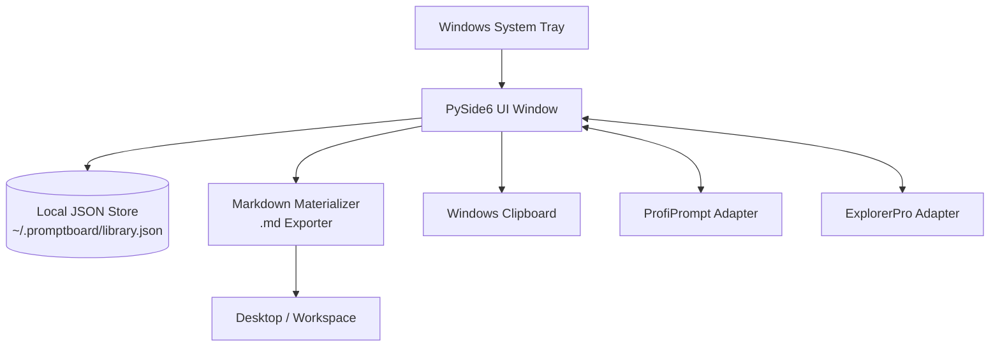
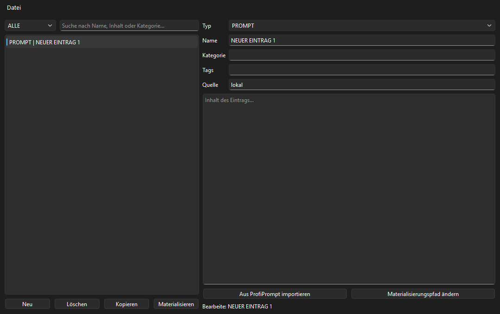
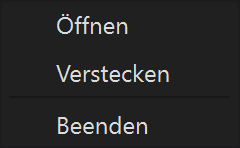
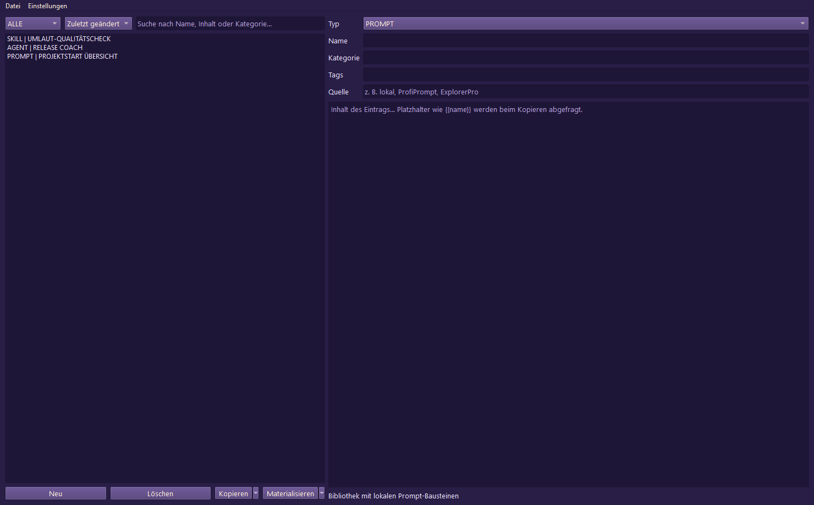
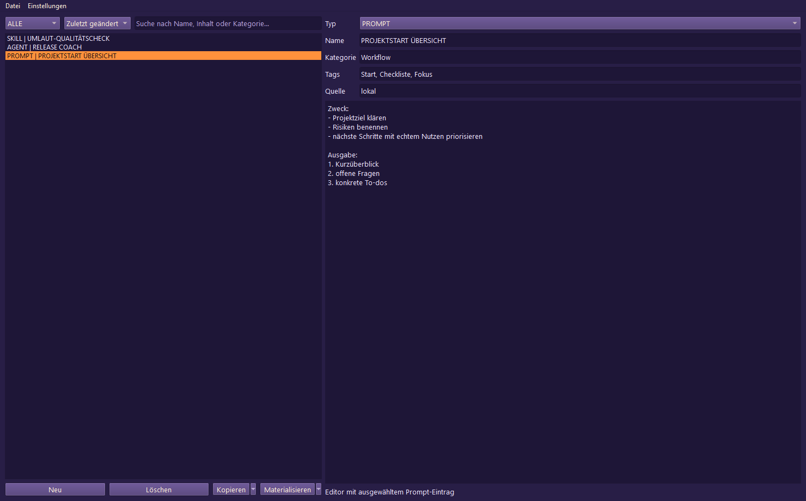
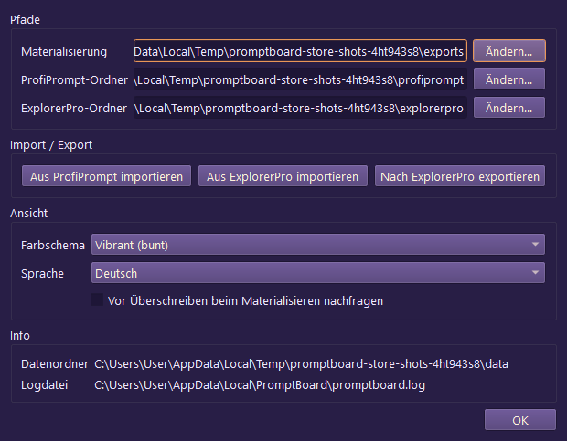

<p>
  <a href="./README_de.md">🇩🇪 Deutsch</a> &nbsp;·&nbsp; <b>🇬🇧 English</b> &nbsp;·&nbsp; <a href="./README_fr.md">🇫🇷 Français</a> &nbsp;·&nbsp; <a href="./README_es.md">🇪🇸 Español</a> &nbsp;·&nbsp; <a href="./README_zh.md">🇨🇳 简体中文</a> &nbsp;·&nbsp; <a href="./README_ja.md">🇯🇵 日本語</a> &nbsp;·&nbsp; <a href="./README_ru.md">🇷🇺 Русский</a> &nbsp;·&nbsp; <a href="./README_hi.md">🇮🇳 हिंदी</a> &nbsp;·&nbsp; <a href="./README_ar.md">🇸🇦 العربية</a> &nbsp;·&nbsp; <a href="./README_bn.md">🇧🇩 বাংলা</a> &nbsp;·&nbsp; <a href="./README_pt.md">🇵🇹 Português</a>
</p>

<p>
  
  
  
  
  
  
  
  
</p>

# PromptBoard

**Your local prompt library — fast, offline, tray-ready.**

> [!NOTE]
> **Disambiguation:** `file-bricks/promptboard` is a native local-first Windows desktop tray application (Python & PySide6) designed for offline LLM prompt management and local Markdown materialization. It is not a cloud web service, SaaS platform, or browser extension.

> [!TIP]
> **LLM / Agent Integration:** See [`llms.txt`](./llms.txt) for machine-readable project context, API boundaries, CLI execution patterns, and architectural invariants.

[Features](#key-features--goals) &nbsp;·&nbsp; [Architecture](#architecture--data-flow) &nbsp;·&nbsp; [Screenshots](#screenshots) &nbsp;·&nbsp; [Install & Run](#running-the-project) &nbsp;·&nbsp; [Docs](#onboarding)

---

PromptBoard is a fast desktop utility and Windows tray application for reusable LLM building blocks: prompts, skills, workflows, roles, and agents. Unlike larger prompt managers, the focus is not on versioning or complex board systems, but on rapid access: open, filter, copy, edit directly, and materialize as `.md` files when needed. Your prompt libraries stay offline, searchable, and copy-ready without requiring a cloud account or external API connections.

## Status

**Phase:** public release (`v1.1.3`), store and platform hardening active in local development<br/>
**Code:** PySide6 desktop application with 126/126 passing pytest tests<br/>

**CI:** [PromptBoard tests](https://github.com/file-bricks/promptboard/actions/workflows/tests.yml) running Windows Pytest and macOS/Linux source smoke checks  
**Repository:** [file-bricks/promptboard](https://github.com/file-bricks/promptboard)  

### Verification readback — 2026-09-18

- `python -X utf8 -m pytest -q`: **125 passed, 1 skipped (126 total)** (scope: the Python test suite; screenshot test skips cleanly under headless offscreen).
- `python -X utf8 tests/source_platform_smoke.py`: **OK** (source/offscreen smoke; it does not claim native macOS/Linux tray or hotkey parity).
- `python -X utf8 -m compileall -q src _tools tests scripts`: **OK**.
- `ruff check src _tools tests scripts`: **OK** (all checks passed).
- GitHub release `v1.1.3` is published; Store-P1 remains open because real
  Partner-Center values, a local MSIX build with `makeappx.exe`, and an
  elevated WACK readback are not yet available.

## Architecture & Data Flow



## Screenshots

The local README preview and the four store views are generated directly from the live UI state.








These store screenshots can be reproducibly regenerated via `_tools/generate_store_screenshots.py`.

## Key Features & Goals

PromptBoard serves as a compact tray tool for managing local knowledge blocks:

- Prompts
- Skills
- Workflows
- Roles
- Agents

Every entry is directly editable, sortable by type and name, and copyable to the clipboard with a single click. A right-click option lets you materialize an entry as a clean Markdown file (`.md`) to a configured location (defaulting to the Desktop). The exported file is content-focused: H1 header, compact metadata block, followed by the actual prompt text.

Global hotkeys allow you to show/hide the tray window and quickly copy the last used entry.

## Sync (server mode)

Synchronization is **off by default** (zero network calls). When desired, open **Settings → Preferences… → Synchronization** and switch **Sync mode** to **Server** to synchronize your library with a self-hosted `prompt-sync-server` instance:

- **Namespace:** `promptboard` (schema `promptboard-library-v1`).
- **Transport & Auth:** Bearer API token stored in the OS keyring when `keyring` (`pip install ".[keyring]"`) is installed, or in a local `0600` file inside your user profile. Plain `http://` is restricted to loopback (`http://127.0.0.1:8765`) or private Tailscale addresses (`100.64.0.0/10`); all other hosts require `https://`.
- **Offline-first & Three-way Conflicts:** Local saves queue immediately in `sync_queue.json` (debounced 3 s, interval polling, and flushed once on quit). Stale writes (`409 Conflict`) and remote tombstones on locally edited entries never overwrite silently — they open a conflict dialog (*Keep local* [default], *Keep as copy*, or *Take server version*). First coupling to a non-empty server prompts once with *Merge* as the non-destructive default.

## Comparison

- **Lighter than ProfiPrompt:** No large version history or heavy board system at the core.
- **More Robust than AutoPrompter:** No fragile keyboard or daemon hook logic.
- **More Private than Cloud Tools:** Purely offline, no account sync, external APIs, or telemetry.

## Onboarding

| For... | Read... |
|---|---|
| First Session | [START.md](./START.md) |
| Current State | [STATE.md](./STATE.md) |
| Product Vision | [KONZEPT.md](./KONZEPT.md) |
| Feature Overview | [Feature_Analyse_PromptBoard.md](./Feature_Analyse_PromptBoard.md) |
| Architecture | [ARCHITECTURE.md](./ARCHITECTURE.md) |
| Glossary | [GLOSSARY.md](./GLOSSARY.md) |
| Agent Guidelines | [AGENTS.md](./AGENTS.md) and [CLAUDE.md](./CLAUDE.md) |

## Next Steps

The next primary focus is completing the Store-P1 path: entering real Partner Center values and documenting the elevated WACK run against `releases/PromptBoard.msix`. The macOS/Linux source smoke tests are now integrated into the project and CI pipeline.

## Running the Project

```powershell
python -m pip install -e ".[dev]"
python src\promptboard.py
```

Under Windows, you can alternatively start the app by double-clicking `start.bat`.

## License

PromptBoard is licensed under [MIT](LICENSE). Runtime dependency licenses are
listed in [THIRD_PARTY_LICENSES.txt](THIRD_PARTY_LICENSES.txt).
