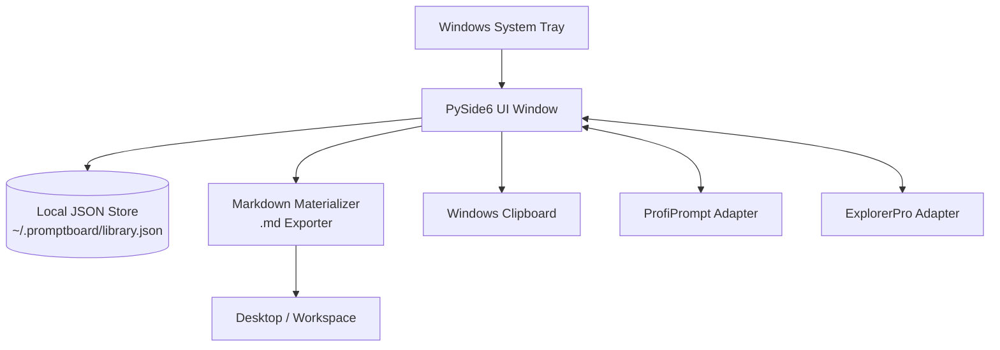
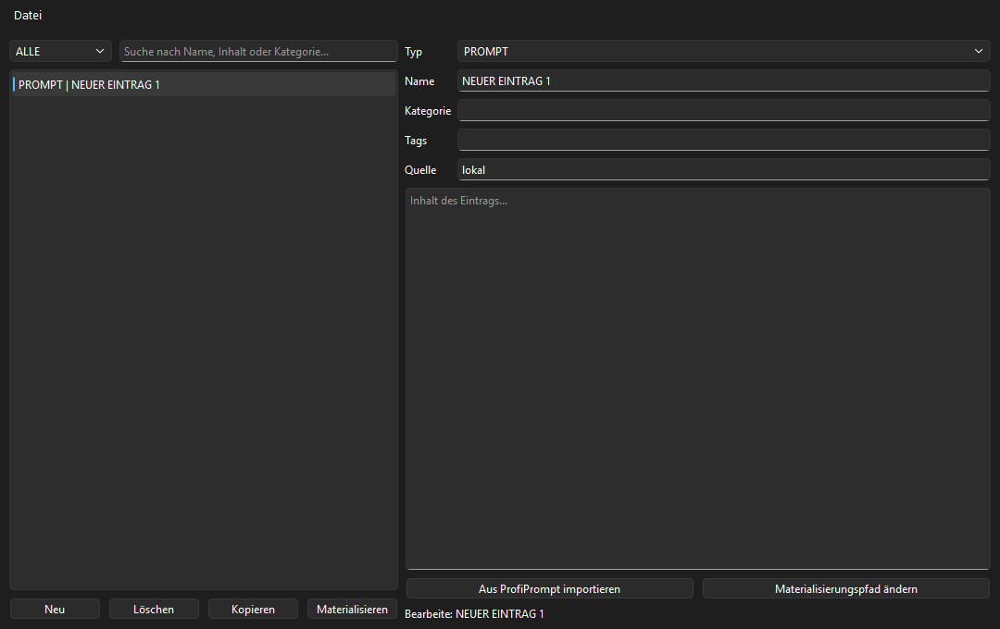
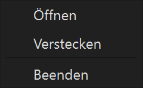
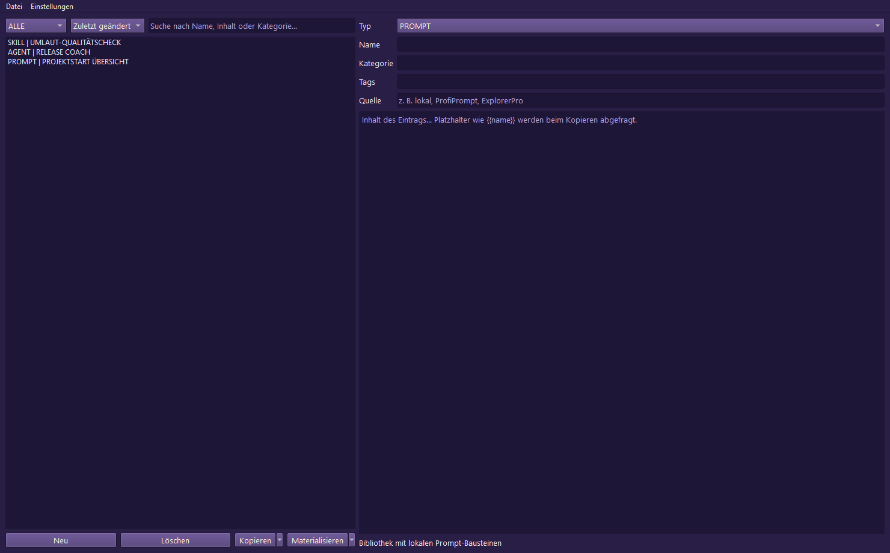
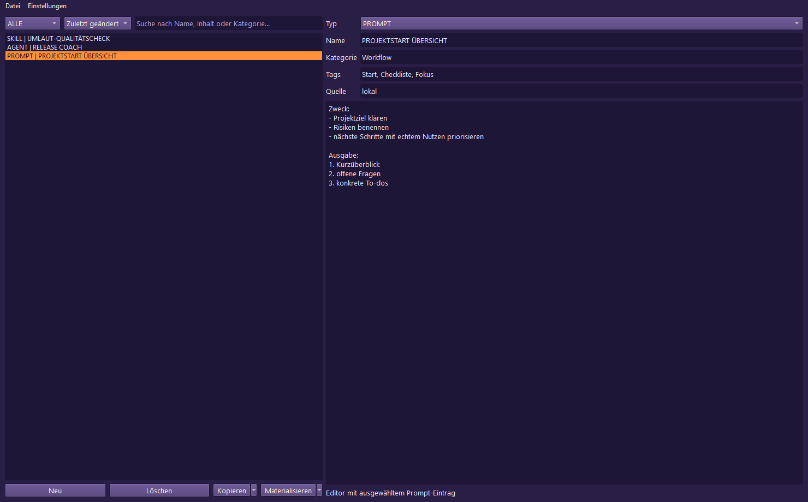
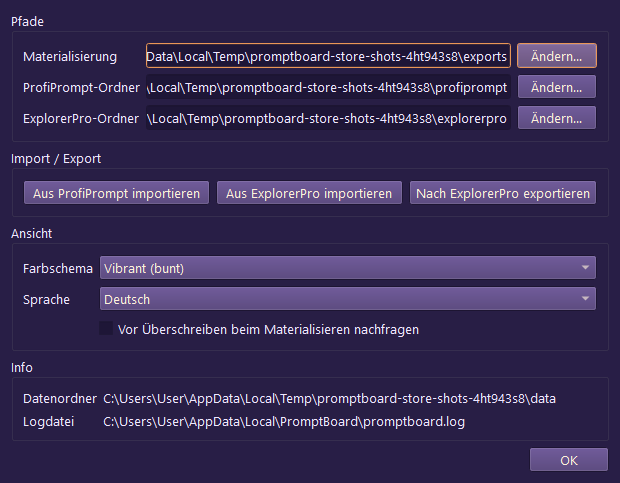

<p>
  <a href="./README_de.md">🇩🇪 Deutsch</a> &nbsp;·&nbsp; <a href="./README.md">🇬🇧 English</a> &nbsp;·&nbsp; <a href="./README_fr.md">🇫🇷 Français</a> &nbsp;·&nbsp; <a href="./README_es.md">🇪🇸 Español</a> &nbsp;·&nbsp; <a href="./README_zh.md">🇨🇳 简体中文</a> &nbsp;·&nbsp; <a href="./README_ja.md">🇯🇵 日本語</a> &nbsp;·&nbsp; <a href="./README_ru.md">🇷🇺 Русский</a> &nbsp;·&nbsp; <a href="./README_hi.md">🇮🇳 हिंदी</a> &nbsp;·&nbsp; <b>🇸🇦 العربية</b> &nbsp;·&nbsp; <a href="./README_bn.md">🇧🇩 বাংলা</a> &nbsp;·&nbsp; <a href="./README_pt.md">🇵🇹 Português</a>
</p>

> ترجمة بمساعدة الذكاء الاصطناعي؛ النسخة الإنجليزية ([README.md](./README.md)) هي المرجع المعتمد. هذه ترجمة للوثائق فقط، ولا يعني توفر الوثائق بالعربية أن واجهة التطبيق تدعم العربية؛ فالواجهة تدعم DE/EN/ES/ZH/JA/RU.

<p>
  
  
  
  
  
  
  
  
</p>

# PromptBoard

**مكتبتك المحلية للموجّهات — سريعة، تعمل دون اتصال، وجاهزة للاستخدام من علبة النظام.**

> [!NOTE]
> **توضيح:** ‏`file-bricks/promptboard` تطبيق سطح مكتب أصلي لنظام Windows، يعمل في علبة النظام ويتبع نهجاً محلياً أولاً (Python وPySide6). صُمّم لإدارة موجّهات LLM دون اتصال وإنشائها محلياً كملفات Markdown. وهو ليس خدمة ويب سحابية ولا منصة SaaS ولا امتداداً للمتصفح.

> [!TIP]
> **تكامل LLM / الوكلاء:** راجع [`llms.txt`](./llms.txt) للاطلاع على سياق المشروع القابل للقراءة آلياً، وحدود API، وأنماط تشغيل CLI، وثوابت البنية المعمارية.

[الميزات والأهداف](#الميزات-والأهداف) &nbsp;·&nbsp; [الهندسة المعمارية](#الهندسة-المعمارية-وتدفق-البيانات) &nbsp;·&nbsp; [لقطات الشاشة](#لقطات-الشاشة) &nbsp;·&nbsp; [التثبيت والتشغيل](#تشغيل-المشروع) &nbsp;·&nbsp; [الوثائق](#البدء)

---

PromptBoard أداة سطح مكتب سريعة وتطبيق لعلبة نظام Windows لإدارة مكوّنات LLM القابلة لإعادة الاستخدام: الموجّهات والمهارات وسير العمل والأدوار والوكلاء. وعلى خلاف مديري الموجّهات الأكبر، لا ينصبّ التركيز على إدارة الإصدارات أو أنظمة اللوحات المعقّدة، بل على الوصول السريع: افتح المحتوى، وصفِّه، وانسخه، وعدّله مباشرة، أو احفظه عند الحاجة في ملفات ‏`.md`. تبقى مكتبات الموجّهات محلية، قابلة للبحث وجاهزة للنسخ، من دون الحاجة إلى حساب سحابي أو اتصال بواجهات API خارجية.

## الحالة

**المرحلة:** إصدار عام (‏`v1.1.3`)، مع استمرار العمل محلياً على تعزيز المتجر والمنصات<br/>
**الشفرة:** تطبيق سطح مكتب مبني على PySide6 مع نجاح 126/126 من اختبارات pytest<br/>

**CI:** تشغّل [اختبارات PromptBoard](https://github.com/file-bricks/promptboard/actions/workflows/tests.yml) اختبارات Pytest على Windows وفحوصاً سريعة للمصدر على macOS/Linux<br/>
**المستودع:** [file-bricks/promptboard](https://github.com/file-bricks/promptboard)

### قراءة التحقق — 2026-09-18

- ‏`python -X utf8 -m pytest -q`: **125 اختباراً ناجحاً، واختبار واحد تم تخطيه (126 إجمالاً)** (النطاق: مجموعة اختبارات Python؛ يتخطّى اختبار لقطات الشاشة بسلاسة عند التشغيل بلا واجهة رسومية في وضع offscreen).
- ‏`python -X utf8 tests/source_platform_smoke.py`: **OK** (فحص سريع للمصدر/offscreen؛ لا يثبت تكافؤاً أصلياً لعلبة النظام أو مفاتيح الاختصار على macOS/Linux).
- ‏`python -X utf8 -m compileall -q src _tools tests scripts`: **OK**.
- ‏`ruff check src _tools tests scripts`: **OK** (اجتازت جميع الفحوص).
- نُشر إصدار GitHub ‏`v1.1.3`؛ ولا يزال Store-P1 مفتوحاً لأن قيم Partner Center الحقيقية، وبناء MSIX محلياً باستخدام ‏`makeappx.exe`، وقراءة WACK بامتيازات مرتفعة غير متاحة بعد.

## الهندسة المعمارية وتدفق البيانات



## لقطات الشاشة

تُنشأ معاينة README المحلية وواجهات المتجر الأربع مباشرةً من الحالة الفعلية لواجهة المستخدم.








يمكن إعادة إنشاء لقطات المتجر هذه بصورة قابلة للتكرار باستخدام ‏`_tools/generate_store_screenshots.py`.

## الميزات والأهداف

PromptBoard أداة صغيرة تعمل من علبة النظام لإدارة وحدات المعرفة المحلية:

- الموجّهات
- المهارات
- سير العمل
- الأدوار
- الوكلاء

يمكن تحرير كل مدخل مباشرةً، وترتيبه بحسب النوع والاسم، ونسخه إلى الحافظة بنقرة واحدة. ويتيح خيار النقر بالزر الأيمن إنشاء ملف Markdown نظيف (‏`.md`) للمدخل في موقع مهيأ، ويكون سطح المكتب هو الموقع الافتراضي. يركّز الملف المُصدَّر على المحتوى: عنوان H1، وكتلة بيانات وصفية موجزة، ثم نص الموجّه نفسه.

تتيح مفاتيح الاختصار العامة إظهار نافذة علبة النظام أو إخفاءها، ونسخ آخر مدخل استُخدم بسرعة.

## المقارنة

- **أخف من ProfiPrompt:** لا يتضمن جوهره سجلاً كبيراً للإصدارات أو نظام لوحات ثقيلاً.
- **أكثر متانة من AutoPrompter:** لا يعتمد على منطق هش لمحاكاة لوحة المفاتيح أو على خطّافات تعمل كخدمات دائمة.
- **أعلى خصوصية من الأدوات السحابية:** يعمل بالكامل دون اتصال، ولا يتطلب مزامنة حساب أو واجهات API خارجية ولا يجمع بيانات القياس عن بُعد.

## البدء

| لمن... | اقرأ... |
|---|---|
| الجلسة الأولى | [START.md](./START.md) |
| الحالة الحالية | [STATE.md](./STATE.md) |
| رؤية المنتج | [KONZEPT.md](./KONZEPT.md) |
| نظرة عامة على الميزات | [Feature_Analyse_PromptBoard.md](./Feature_Analyse_PromptBoard.md) |
| الهندسة المعمارية | [ARCHITECTURE.md](./ARCHITECTURE.md) |
| مسرد المصطلحات | [GLOSSARY.md](./GLOSSARY.md) |
| إرشادات الوكلاء | [AGENTS.md](./AGENTS.md) و[CLAUDE.md](./CLAUDE.md) |

## الخطوات التالية

التركيز الرئيسي التالي هو إكمال مسار Store-P1: إدخال قيم Partner Center الحقيقية وتوثيق تشغيل WACK بامتيازات مرتفعة على ‏`releases/PromptBoard.msix`. وقد أُدرجت الآن اختبارات المصدر السريعة لـmacOS/Linux في المشروع وخط CI.

## تشغيل المشروع

```powershell
python -m pip install -e ".[dev]"
python src\promptboard.py
```

على Windows، يمكن أيضاً تشغيل التطبيق بالنقر المزدوج على ‏`start.bat`.

## الترخيص

يُوزَّع PromptBoard بموجب ترخيص [MIT](LICENSE). وتُدرج تراخيص تبعيات وقت التشغيل في [THIRD_PARTY_LICENSES.txt](THIRD_PARTY_LICENSES.txt).
