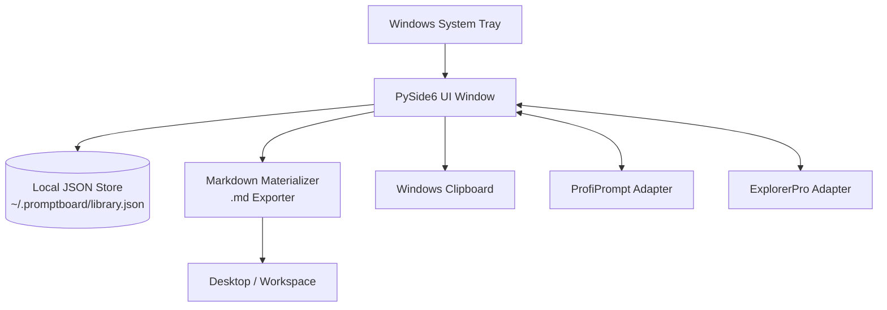
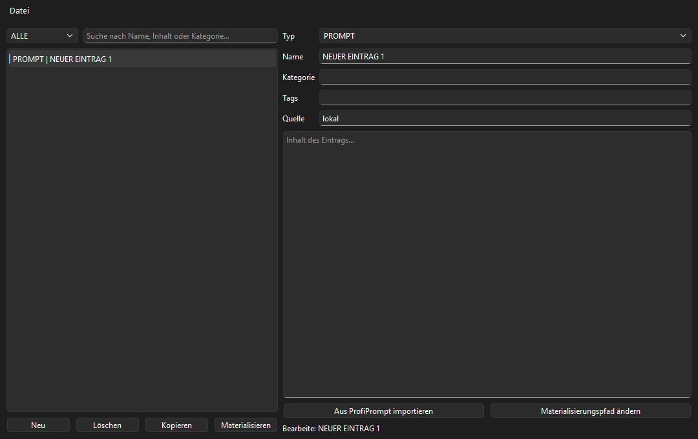
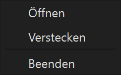
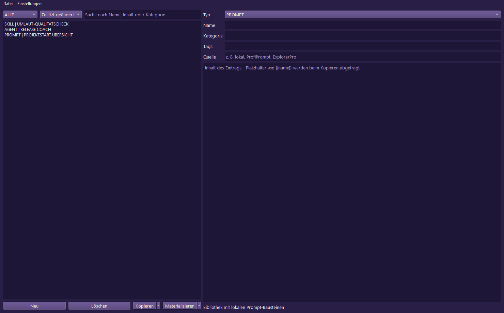
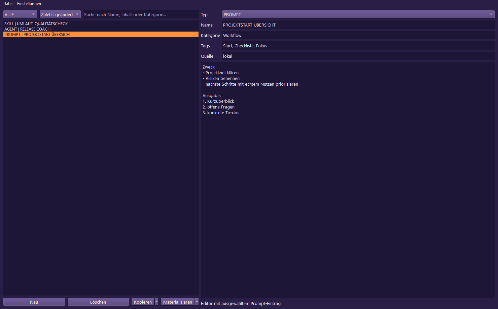
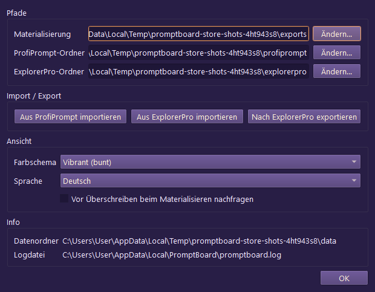

<p>
  <a href="./README.md">🇬🇧 English</a> &nbsp;·&nbsp; <a href="./README_de.md">🇩🇪 Deutsch</a> &nbsp;·&nbsp; <a href="./README_es.md">🇪🇸 Español</a> &nbsp;·&nbsp; <a href="./README_fr.md">🇫🇷 Français</a> &nbsp;·&nbsp; <a href="./README_zh.md">🇨🇳 简体中文</a> &nbsp;·&nbsp; <a href="./README_ja.md">🇯🇵 日本語</a> &nbsp;·&nbsp; <a href="./README_ru.md">🇷🇺 Русский</a> &nbsp;·&nbsp; <a href="./README_hi.md">🇮🇳 हिंदी</a> &nbsp;·&nbsp; <a href="./README_ar.md">🇸🇦 العربية</a> &nbsp;·&nbsp; <b>🇧🇩 বাংলা</b> &nbsp;·&nbsp; <a href="./README_pt.md">🇵🇹 Português</a>
</p>

<p>
  
  
  
  
  
  
  
  
</p>

# PromptBoard

**আপনার স্থানীয় প্রম্পট লাইব্রেরি—দ্রুত, অফলাইনে, সিস্টেম ট্রেতে প্রস্তুত।**

> [!NOTE]
> **পরিচয় স্পষ্টীকরণ:** `file-bricks/promptboard` হলো Python ও PySide6 দিয়ে তৈরি Windows-এর একটি স্থানীয়-প্রথম ডেস্কটপ ট্রে অ্যাপ। এটি অফলাইনে LLM প্রম্পট পরিচালনা এবং Markdown ফাইল স্থানীয়ভাবে তৈরি করার জন্য বানানো হয়েছে। এটি কোনো ক্লাউড ওয়েব পরিষেবা, SaaS প্ল্যাটফর্ম বা ব্রাউজার এক্সটেনশন নয়।

> [!TIP]
> **LLM / এজেন্ট সংযোগ:** মেশিনে-পাঠযোগ্য প্রকল্প-প্রসঙ্গ, API-এর সীমানা, CLI চালানোর ধরন এবং স্থাপত্যগত অপরিবর্তনীয় নিয়মের জন্য [`llms.txt`](./llms.txt) দেখুন।

[বৈশিষ্ট্য](#key-features--goals) &nbsp;·&nbsp; [স্থাপত্য](#architecture--data-flow) &nbsp;·&nbsp; [স্ক্রিনশট](#screenshots) &nbsp;·&nbsp; [ইনস্টল ও চালানো](#running-the-project) &nbsp;·&nbsp; [নথি](#onboarding)

---

PromptBoard হলো পুনর্ব্যবহারযোগ্য LLM উপাদান—প্রম্পট, স্কিল, ওয়ার্কফ্লো, ভূমিকা এবং এজেন্ট—পরিচালনার জন্য একটি দ্রুত ডেস্কটপ ইউটিলিটি ও Windows ট্রে অ্যাপ। বড় প্রম্পট ম্যানেজারগুলোর মতো সংস্করণ-ইতিহাস বা জটিল বোর্ড-ব্যবস্থায় এর মূল জোর নয়; এখানে লক্ষ্য দ্রুত ব্যবহার: খুলুন, ফিল্টার করুন, কপি করুন, সরাসরি সম্পাদনা করুন এবং প্রয়োজন হলে `.md` ফাইল হিসেবে তৈরি করুন। আপনার প্রম্পট লাইব্রেরি অফলাইন, অনুসন্ধানযোগ্য এবং কপি করার জন্য প্রস্তুত থাকে—ক্লাউড অ্যাকাউন্ট বা বাহ্যিক API সংযোগের প্রয়োজন ছাড়াই।

## অবস্থা

**পর্যায়:** `v1.1.3`-এর সর্বসাধারণের জন্য প্রকাশ; স্থানীয় উন্নয়নে স্টোর ও প্ল্যাটফর্ম-সংক্রান্ত কঠোরীকরণের কাজ চলছে<br/>
**কোড:** PySide6 ডেস্কটপ অ্যাপ্লিকেশন; pytest পরীক্ষার 126/126টি পাস করেছে<br/>

**CI:** [PromptBoard পরীক্ষা](https://github.com/file-bricks/promptboard/actions/workflows/tests.yml) Windows-এ Pytest এবং macOS/Linux-এ সোর্স স্মোক চেক চালায়<br/>
**রিপোজিটরি:** [file-bricks/promptboard](https://github.com/file-bricks/promptboard)<br/>

### যাচাইয়ের ফল — 2026-09-18

- `python -X utf8 -m pytest -q`: **125টি পাস, 1টি স্কিপ (মোট 126টি)** (পরিধি: Python টেস্ট স্যুট; গ্রাফিক্যাল ডিসপ্লে ছাড়া (headless) পরিবেশে offscreen মোডে চালালে স্ক্রিনশট পরীক্ষাটি স্বাভাবিকভাবেই এড়িয়ে যায়)।
- `python -X utf8 tests/source_platform_smoke.py`: **OK** (সোর্স/offscreen স্মোক পরীক্ষা; এটি macOS/Linux-এ নেটিভ ট্রে বা হটকি সমতা দাবি করে না)।
- `python -X utf8 -m compileall -q src _tools tests scripts`: **OK**।
- `ruff check src _tools tests scripts`: **OK** (সব যাচাই পাস করেছে)।
- GitHub release `v1.1.3` প্রকাশিত হয়েছে; বাস্তব Partner Center মান, `makeappx.exe` দিয়ে স্থানীয়ভাবে MSIX তৈরি এবং উন্নত প্রশাসনিক অধিকার নিয়ে চালানো WACK-এর ফল যাচাই এখনও না থাকায় Store-P1 খোলা রয়েছে।

<a id="architecture--data-flow"></a>
## স্থাপত্য ও ডেটা প্রবাহ



<a id="screenshots"></a>
## স্ক্রিনশট

স্থানীয় README প্রিভিউ এবং স্টোরের চারটি ভিউ, লাইভ UI-এর অবস্থা থেকেই তৈরি করা হয়।








এই স্টোরের স্ক্রিনশটগুলো `_tools/generate_store_screenshots.py` দিয়ে পুনরুৎপাদনযোগ্যভাবে তৈরি করা যায়।

<a id="key-features--goals"></a>
## প্রধান বৈশিষ্ট্য ও লক্ষ্য

PromptBoard স্থানীয় জ্ঞান-উপাদান পরিচালনার জন্য একটি সংক্ষিপ্ত ট্রে টুল:

- প্রম্পট
- স্কিল
- ওয়ার্কফ্লো
- ভূমিকা
- এজেন্ট

প্রতিটি এন্ট্রি সরাসরি সম্পাদনা করা যায়, ধরন ও নাম অনুসারে সাজানো যায় এবং এক ক্লিকে ক্লিপবোর্ডে কপি করা যায়। ডান-ক্লিকের একটি বিকল্পে এন্ট্রিকে পরিচ্ছন্ন Markdown ফাইল (`.md`) হিসেবে নির্দিষ্ট স্থানে তৈরি করা যায় (ডিফল্ট হলো Desktop)। রপ্তানি করা ফাইলের বিষয়বস্তু-কেন্দ্রিক বিন্যাস: H1 শিরোনাম, সংক্ষিপ্ত মেটাডেটার অংশ, তারপর আসল প্রম্পটের লেখা।

গ্লোবাল হটকি দিয়ে ট্রে উইন্ডো দেখানো/লুকানো এবং সর্বশেষ ব্যবহৃত এন্ট্রি দ্রুত কপি করা যায়।

## তুলনা

- **ProfiPrompt-এর চেয়ে হালকা:** মূল ব্যবস্থায় বড় সংস্করণ-ইতিহাস বা ভারী বোর্ড সিস্টেম নেই।
- **AutoPrompter-এর চেয়ে বেশি নির্ভরযোগ্য:** ভঙ্গুর কিবোর্ড বা ডেমন-হুক যুক্তি নেই।
- **ক্লাউড টুলের চেয়ে বেশি ব্যক্তিগত:** সম্পূর্ণ অফলাইন; অ্যাকাউন্ট সিঙ্ক, বাহ্যিক API বা টেলিমেট্রি নেই।

<a id="onboarding"></a>
## শুরু করার নির্দেশিকা

| যাঁদের জন্য... | পড়ুন... |
|---|---|
| প্রথম সেশন | [START.md](./START.md) |
| বর্তমান অবস্থা | [STATE.md](./STATE.md) |
| পণ্যের দিশা | [KONZEPT.md](./KONZEPT.md) |
| বৈশিষ্ট্যের সারাংশ | [Feature_Analyse_PromptBoard.md](./Feature_Analyse_PromptBoard.md) |
| স্থাপত্য | [ARCHITECTURE.md](./ARCHITECTURE.md) |
| শব্দকোষ | [GLOSSARY.md](./GLOSSARY.md) |
| এজেন্ট নির্দেশিকা | [AGENTS.md](./AGENTS.md) এবং [CLAUDE.md](./CLAUDE.md) |

## পরবর্তী পদক্ষেপ

পরবর্তী প্রধান লক্ষ্য হলো Store-P1 পথ সম্পূর্ণ করা: বাস্তব Partner Center মান প্রবেশ করানো এবং `releases/PromptBoard.msix`-এর বিরুদ্ধে উন্নত প্রশাসনিক অধিকার নিয়ে চালানো WACK-এর ফল যাচাই নথিবদ্ধ করা। macOS/Linux সোর্স স্মোক পরীক্ষাগুলো এখন প্রকল্প ও CI পাইপলাইনে অন্তর্ভুক্ত।

<a id="running-the-project"></a>
## প্রকল্প চালানো

```powershell
python -m pip install -e ".[dev]"
python src\promptboard.py
```

Windows-এ বিকল্পভাবে `start.bat`-এ ডাবল-ক্লিক করে অ্যাপ চালু করা যায়।

## লাইসেন্স

PromptBoard [MIT](LICENSE)-এর অধীনে লাইসেন্সপ্রাপ্ত। রানটাইম নির্ভরতাগুলোর লাইসেন্স
[THIRD_PARTY_LICENSES.txt](THIRD_PARTY_LICENSES.txt)-এ তালিকাভুক্ত।
