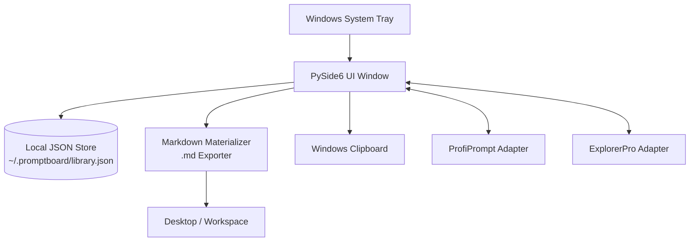
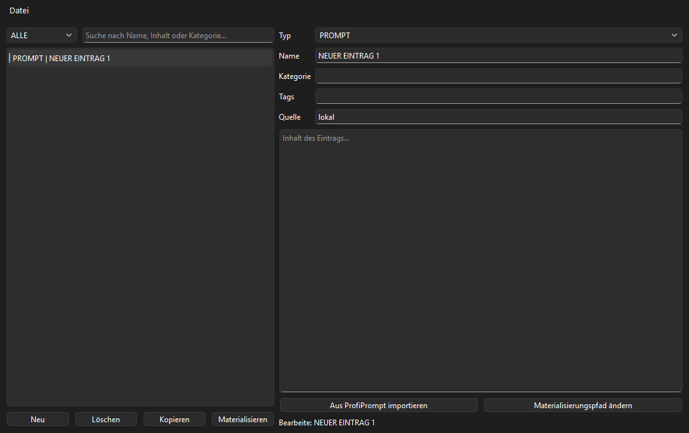
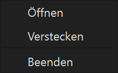
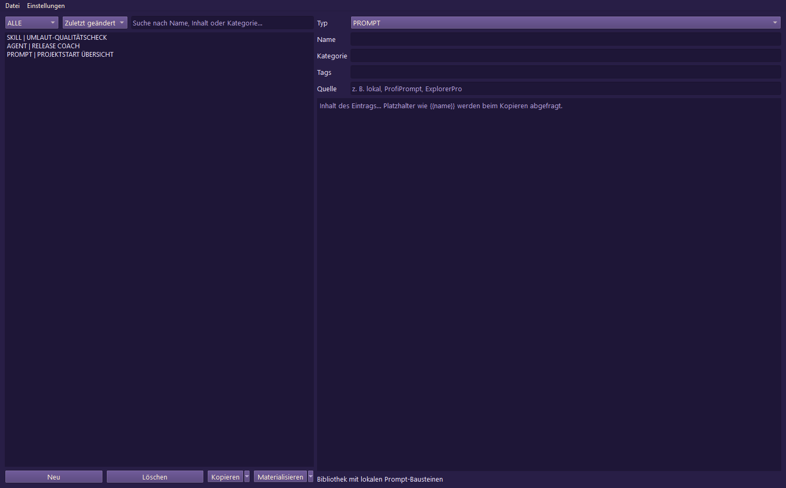
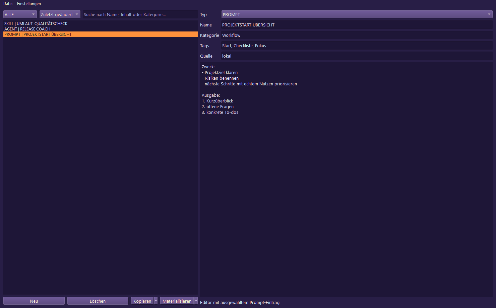
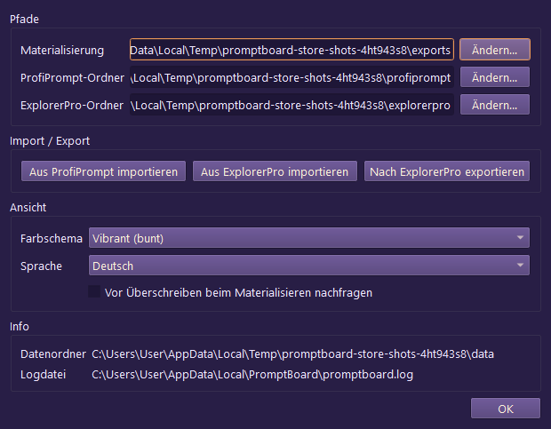

<p>
  <a href="./README_de.md">🇩🇪 Deutsch</a> &nbsp;·&nbsp; <a href="./README.md">🇬🇧 English</a> &nbsp;·&nbsp; <b>🇫🇷 Français</b> &nbsp;·&nbsp; <a href="./README_es.md">🇪🇸 Español</a> &nbsp;·&nbsp; <a href="./README_zh.md">🇨🇳 简体中文</a> &nbsp;·&nbsp; <a href="./README_ja.md">🇯🇵 日本語</a> &nbsp;·&nbsp; <a href="./README_ru.md">🇷🇺 Русский</a>
</p>

> Traduction assistée par l’IA ; la version anglaise ([README.md](README.md)) fait autorité.

<p>
  
  
  
  
  
  
  
  
</p>

# PromptBoard

**Votre bibliothèque locale de prompts : rapide, hors ligne et accessible depuis la zone de notification.**

> [!NOTE]
> **Précision :** `file-bricks/promptboard` est une application de bureau native pour Windows, conçue selon une approche locale d’abord et résidant dans la zone de notification (Python & PySide6). Elle permet de gérer des prompts LLM hors ligne et de les matérialiser localement en fichiers Markdown. Ce n’est pas un service Web dans le cloud, une plateforme SaaS ni une extension de navigateur.

> [!TIP]
> **Intégration aux LLM et aux agents :** consultez [`llms.txt`](./llms.txt) pour le contexte du projet lisible par machine, les limites de l’API, les modes d’exécution de la CLI et les invariants d’architecture.

[Fonctionnalités](#fonctionnalités-et-objectifs) &nbsp;·&nbsp; [Architecture](#architecture-et-flux-de-données) &nbsp;·&nbsp; [Captures d’écran](#captures-décran) &nbsp;·&nbsp; [Installer et exécuter](#exécuter-le-projet) &nbsp;·&nbsp; [Documentation](#premiers-pas)

---

PromptBoard est un utilitaire de bureau rapide et une application Windows résidente dans la zone de notification, destinée à gérer des blocs réutilisables pour les LLM : prompts, compétences, flux de travail, rôles et agents. Contrairement aux gestionnaires de prompts plus complets, son objectif n’est ni l’historique des versions ni des systèmes de tableaux complexes, mais l’accès rapide : ouvrir, filtrer, copier, modifier directement et, au besoin, matérialiser en fichiers `.md`. Vos bibliothèques de prompts restent hors ligne, consultables et prêtes à copier, sans compte cloud ni connexion à une API externe.

## Statut

**Phase :** version publique (`v1.1.3`), durcissement du Store et des plateformes en cours dans le développement local<br/>
**Code :** application de bureau PySide6 avec 126/126 tests pytest réussis<br/>

**CI :** [Tests PromptBoard](https://github.com/file-bricks/promptboard/actions/workflows/tests.yml) exécutant Pytest sous Windows et des vérifications de fumée de la source sous macOS/Linux<br/>
**Dépôt :** [file-bricks/promptboard](https://github.com/file-bricks/promptboard)

### Vérification — 2026-09-18

- `python -X utf8 -m pytest -q` : **125 réussis, 1 ignoré (126 au total)** (périmètre : suite de tests Python ; le test de capture d’écran est ignoré proprement en mode hors écran sans interface).
- `python -X utf8 tests/source_platform_smoke.py` : **OK** (vérification source/hors écran ; elle ne prétend pas établir la parité native de l’intégration à la zone de notification ou des raccourcis sous macOS/Linux).
- `python -X utf8 -m compileall -q src _tools tests scripts` : **OK**.
- `ruff check src _tools tests scripts` : **OK** (tous les contrôles ont réussi).
- La version `v1.1.3` est publiée sur GitHub ; Store-P1 reste ouvert, car les valeurs réelles de Partner Center, une compilation MSIX locale avec `makeappx.exe` et un compte rendu WACK avec privilèges élevés ne sont pas encore disponibles.

## Architecture et flux de données



## Captures d’écran

L’aperçu local du README et les quatre vues du Store sont générés directement à partir de l’état réel de l’interface utilisateur.








Ces captures d’écran du Store peuvent être régénérées de façon reproductible avec `_tools/generate_store_screenshots.py`.

## Fonctionnalités et objectifs

PromptBoard est un outil compact, résident dans la zone de notification, pour gérer des blocs de connaissances locaux :

- Prompts
- Compétences
- Flux de travail
- Rôles
- Agents

Chaque entrée peut être modifiée directement, triée par type et par nom, et copiée dans le presse-papiers en un clic. Une option du menu contextuel permet de matérialiser une entrée en fichier Markdown (`.md`) propre dans un emplacement configuré (le Bureau par défaut). Le fichier exporté est centré sur le contenu : titre H1, bloc de métadonnées compact, puis texte du prompt.

Des raccourcis clavier globaux permettent d’afficher ou de masquer la fenêtre de la zone de notification et de copier rapidement la dernière entrée utilisée.

## Comparaison

- **Plus léger que ProfiPrompt :** pas d’historique des versions volumineux ni de système de tableaux complexe au cœur du produit.
- **Plus robuste qu’AutoPrompter :** aucune logique fragile de saisie au clavier ni de hook de démon.
- **Plus respectueux de la vie privée que les outils cloud :** entièrement hors ligne, sans synchronisation de compte, API externe ni télémétrie.

## Premiers pas

| Pour… | À lire… |
|---|---|
| Première session | [START.md](./START.md) |
| État actuel | [STATE.md](./STATE.md) |
| Vision du produit | [KONZEPT.md](./KONZEPT.md) |
| Présentation des fonctionnalités | [Feature_Analyse_PromptBoard.md](./Feature_Analyse_PromptBoard.md) |
| Architecture | [ARCHITECTURE.md](./ARCHITECTURE.md) |
| Glossaire | [GLOSSARY.md](./GLOSSARY.md) |
| Consignes pour les agents | [AGENTS.md](./AGENTS.md) et [CLAUDE.md](./CLAUDE.md) |

## Prochaines étapes

La prochaine priorité est de terminer le parcours Store-P1 : renseigner les valeurs réelles dans Partner Center et documenter l’exécution de WACK avec privilèges élevés sur `releases/PromptBoard.msix`. Les tests de fumée de la source sous macOS/Linux sont désormais intégrés au projet et au pipeline CI.

## Exécuter le projet

```powershell
python -m pip install -e ".[dev]"
python src\promptboard.py
```

Sous Windows, vous pouvez aussi lancer l’application en double-cliquant sur `start.bat`.

## Licence

PromptBoard est distribué sous licence [MIT](LICENSE). Les licences des dépendances d’exécution sont répertoriées dans [THIRD_PARTY_LICENSES.txt](THIRD_PARTY_LICENSES.txt).
