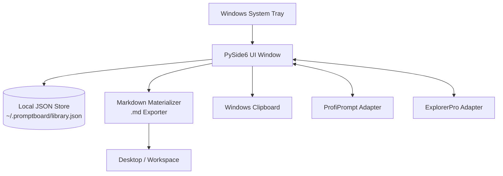
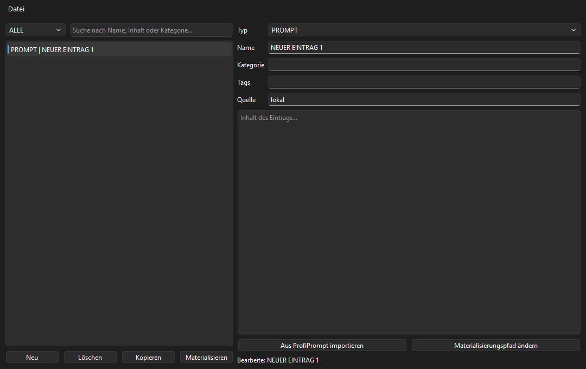
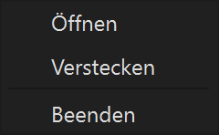
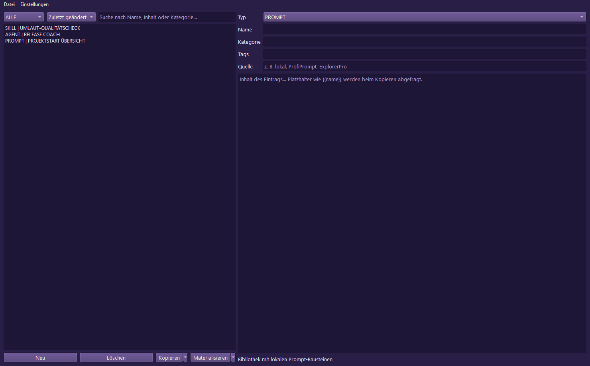
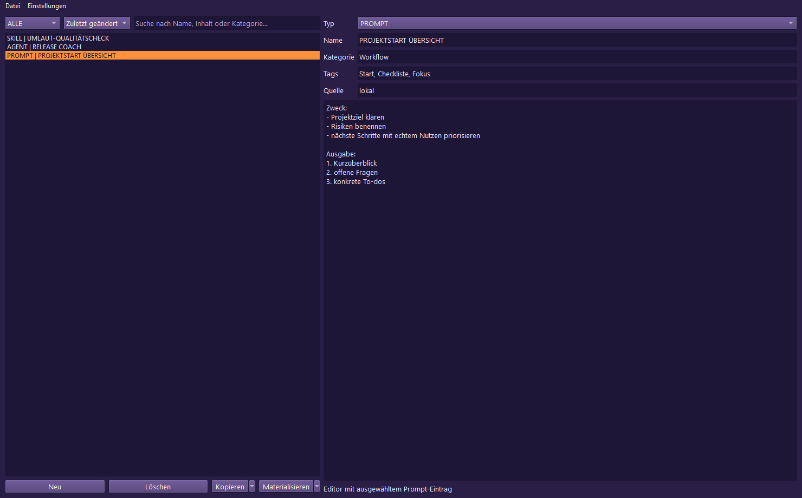
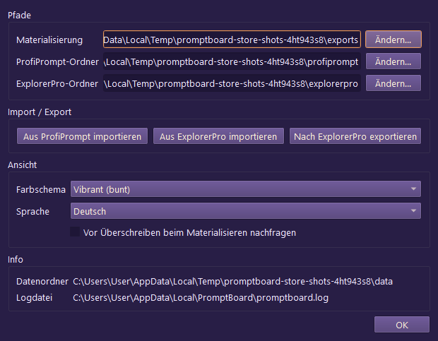

<p>
  <a href="./README_de.md">🇩🇪 Deutsch</a> &nbsp;·&nbsp; <a href="./README.md">🇬🇧 English</a> &nbsp;·&nbsp; <a href="./README_fr.md">🇫🇷 Français</a> &nbsp;·&nbsp; <a href="./README_es.md">🇪🇸 Español</a> &nbsp;·&nbsp; <a href="./README_zh.md">🇨🇳 简体中文</a> &nbsp;·&nbsp; <a href="./README_ja.md">🇯🇵 日本語</a> &nbsp;·&nbsp; <a href="./README_ru.md">🇷🇺 Русский</a> &nbsp;·&nbsp; <b>🇮🇳 हिंदी</b> &nbsp;·&nbsp; <a href="./README_ar.md">🇸🇦 العربية</a>
</p>

> यह दस्तावेज़ हिंदी अनुवाद है; परियोजना का प्रामाणिक विवरण अंग्रेज़ी [README.md](./README.md) है। हिंदी भाषा केवल दस्तावेज़ के लिए उपलब्ध है। ऐप का इंटरफ़ेस अभी DE/EN/ES/ZH/JA/RU भाषाओं का समर्थन करता है।

<p>
  
  
  
  
  
  
  
  
</p>

# PromptBoard

**आपकी स्थानीय प्रॉम्प्ट लाइब्रेरी — तेज़, ऑफ़लाइन और सिस्टम ट्रे से तुरंत उपलब्ध।**

> [!NOTE]
> **स्पष्टता:** `file-bricks/promptboard` एक नेटिव, स्थानीय-प्रथम Windows डेस्कटॉप ट्रे ऐप है (Python और PySide6), जिसे ऑफ़लाइन LLM प्रॉम्प्ट प्रबंधन और स्थानीय Markdown फ़ाइलें बनाने के लिए बनाया गया है। यह क्लाउड वेब सेवा, SaaS प्लेटफ़ॉर्म या ब्राउज़र एक्सटेंशन नहीं है।

> [!TIP]
> **LLM / एजेंट एकीकरण:** मशीन-पठनीय परियोजना संदर्भ, API सीमाएँ, CLI चलाने के तरीके और वास्तु-संबंधी स्थिर नियम के लिए [`llms.txt`](./llms.txt) देखें।

[मुख्य विशेषताएँ और लक्ष्य](#मुख्य-विशेषताएँ-और-लक्ष्य) &nbsp;·&nbsp; [वास्तुकला और डेटा प्रवाह](#वास्तुकला-और-डेटा-प्रवाह) &nbsp;·&nbsp; [स्क्रीनशॉट](#स्क्रीनशॉट) &nbsp;·&nbsp; [प्रोजेक्ट चलाना](#परियोजना-चलाना) &nbsp;·&nbsp; [आरंभिक मार्गदर्शन](#आरंभिक-मार्गदर्शन)

---

PromptBoard एक तेज़ डेस्कटॉप टूल और Windows सिस्टम-ट्रे ऐप है, जिसमें LLM के लिए दोबारा इस्तेमाल किए जा सकने वाले घटक रखे जा सकते हैं: प्रॉम्प्ट, स्किल, वर्कफ़्लो, भूमिकाएँ और एजेंट। बड़े प्रॉम्प्ट प्रबंधकों की तरह इसका मुख्य उद्देश्य संस्करण-प्रबंधन या जटिल बोर्ड प्रणाली नहीं है, बल्कि जल्दी पहुँच है: खोलें, फ़िल्टर करें, कॉपी करें, सीधे संपादित करें और ज़रूरत पड़ने पर `.md` फ़ाइल बनाएँ। आपकी प्रॉम्प्ट लाइब्रेरी ऑफ़लाइन रहती है, उसमें खोज की जा सकती है और सामग्री तुरंत कॉपी की जा सकती है—इसके लिए क्लाउड खाते या बाहरी API कनेक्शन की ज़रूरत नहीं है।

## स्थिति

**चरण:** सार्वजनिक रिलीज़ (`v1.1.3`); Store और प्लेटफ़ॉर्म की मजबूती पर स्थानीय विकास में काम जारी है<br/>
**कोड:** PySide6 डेस्कटॉप ऐप; pytest के 126/126 परीक्षण सफल

**CI:** [PromptBoard tests](https://github.com/file-bricks/promptboard/actions/workflows/tests.yml) Windows पर Pytest और macOS/Linux पर source smoke checks चलाता है<br/>
**Repository:** [file-bricks/promptboard](https://github.com/file-bricks/promptboard)

### सत्यापन विवरण — 2026-09-18

- `python -X utf8 -m pytest -q`: **125 पास, 1 छोड़ा गया (कुल 126)** (दायरा: Python परीक्षण-संग्रह; headless offscreen मोड में screenshot परीक्षण साफ़ तौर पर छोड़ दिया जाता है)।
- `python -X utf8 tests/source_platform_smoke.py`: **OK** (source/offscreen smoke; इससे macOS/Linux पर नेटिव tray या hotkey की समानता का दावा नहीं किया जाता)।
- `python -X utf8 -m compileall -q src _tools tests scripts`: **OK**।
- `ruff check src _tools tests scripts`: **OK** (सभी जाँचें सफल)।
- GitHub रिलीज़ `v1.1.3` प्रकाशित है; Store-P1 अभी खुला है क्योंकि Partner Center के वास्तविक मान, `makeappx.exe` से स्थानीय MSIX build और elevated WACK readback अभी उपलब्ध नहीं हैं।

## वास्तुकला और डेटा प्रवाह



## स्क्रीनशॉट

स्थानीय README पूर्वावलोकन और Store के चार दृश्य, चालू UI स्थिति से सीधे तैयार किए जाते हैं।








इन Store स्क्रीनशॉट को `_tools/generate_store_screenshots.py` के ज़रिए दोबारा बनाया जा सकता है।

## मुख्य विशेषताएँ और लक्ष्य

PromptBoard स्थानीय ज्ञान-सामग्री के घटकों को सँभालने वाला एक संक्षिप्त ट्रे टूल है:

- प्रॉम्प्ट
- स्किल
- वर्कफ़्लो
- भूमिकाएँ
- एजेंट

हर प्रविष्टि को सीधे संपादित किया जा सकता है, प्रकार और नाम के आधार पर क्रमबद्ध किया जा सकता है, और एक क्लिक से क्लिपबोर्ड में कॉपी किया जा सकता है। दायाँ-क्लिक करके किसी प्रविष्टि को साफ़ Markdown फ़ाइल (`.md`) के रूप में कॉन्फ़िगर किए गए स्थान पर बनाया जा सकता है; डिफ़ॉल्ट जगह Desktop है। निर्यात की गई फ़ाइल में केवल उपयोगी सामग्री रहती है: H1 शीर्षक, संक्षिप्त मेटाडेटा ब्लॉक और उसके बाद वास्तविक प्रॉम्प्ट पाठ।

वैश्विक हॉटकी से ट्रे विंडो को दिखाया या छिपाया जा सकता है और आख़िरी बार इस्तेमाल की गई प्रविष्टि तुरंत कॉपी की जा सकती है।

## तुलना

- **ProfiPrompt से हल्का:** लंबा संस्करण इतिहास या भारी बोर्ड प्रणाली इसका मूल हिस्सा नहीं है।
- **AutoPrompter से अधिक मज़बूत:** इसमें नाज़ुक कीबोर्ड या daemon hook की व्यवस्था नहीं है।
- **क्लाउड टूल्स से अधिक गोपनीय:** पूरी तरह ऑफ़लाइन; खाता-सिंक, बाहरी API या telemetry नहीं।

## आरंभिक मार्गदर्शन

| किसके लिए... | पढ़ें... |
|---|---|
| पहला सत्र | [START.md](./START.md) |
| मौजूदा स्थिति | [STATE.md](./STATE.md) |
| उत्पाद दृष्टि | [KONZEPT.md](./KONZEPT.md) |
| सुविधाओं का अवलोकन | [Feature_Analyse_PromptBoard.md](./Feature_Analyse_PromptBoard.md) |
| वास्तुकला | [ARCHITECTURE.md](./ARCHITECTURE.md) |
| शब्दावली | [GLOSSARY.md](./GLOSSARY.md) |
| एजेंट दिशानिर्देश | [AGENTS.md](./AGENTS.md) और [CLAUDE.md](./CLAUDE.md) |

## अगले कदम

अगला मुख्य काम Store-P1 प्रक्रिया पूरी करना है: Partner Center के वास्तविक मान दर्ज करना और `releases/PromptBoard.msix` के लिए elevated WACK चलाकर उसका विवरण दर्ज करना। macOS/Linux source smoke tests अब परियोजना और CI पाइपलाइन में शामिल हैं।

## परियोजना चलाना

```powershell
python -m pip install -e ".[dev]"
python src\promptboard.py
```

Windows में ऐप को `start.bat` पर डबल-क्लिक करके भी शुरू किया जा सकता है।

## लाइसेंस

PromptBoard [MIT](LICENSE) के अंतर्गत लाइसेंस प्राप्त है। रनटाइम निर्भरताओं के लाइसेंस [THIRD_PARTY_LICENSES.txt](THIRD_PARTY_LICENSES.txt) में सूचीबद्ध हैं।
