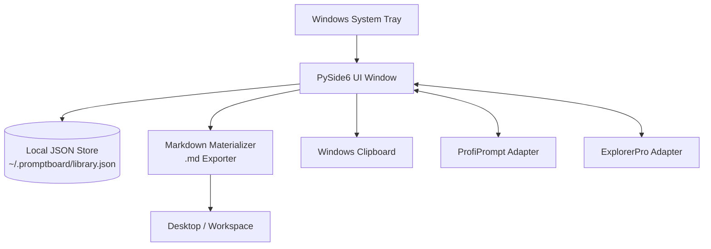
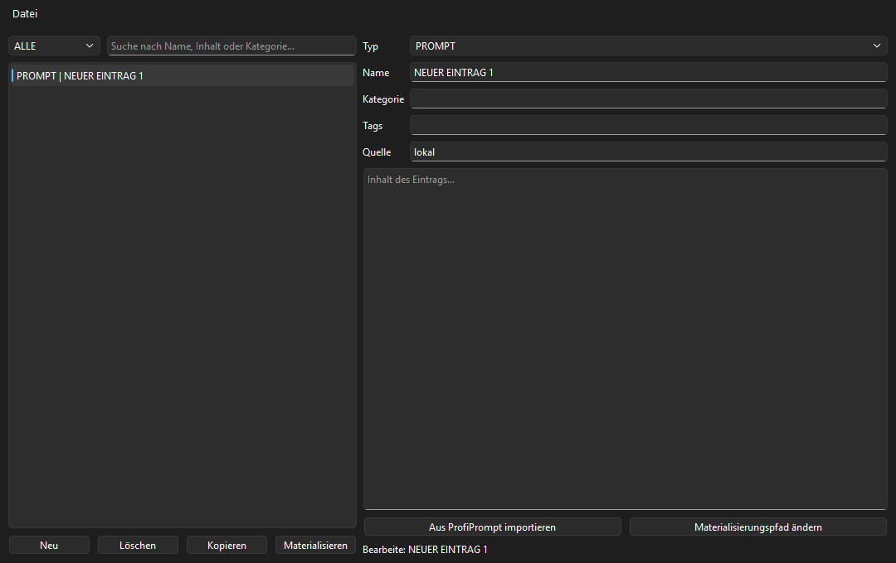
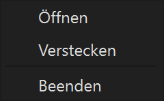
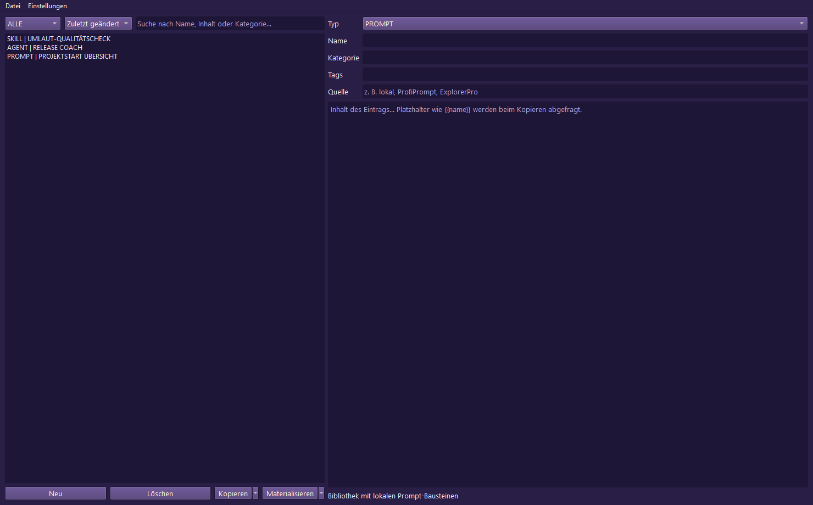
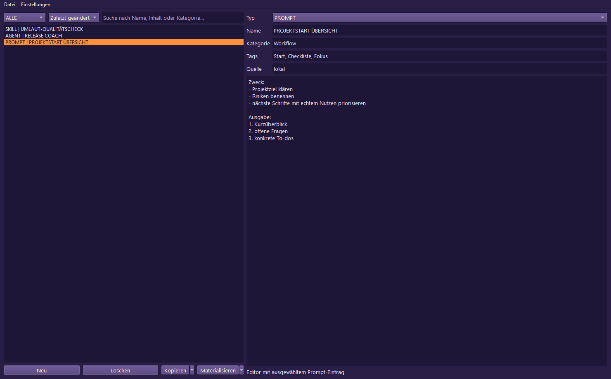
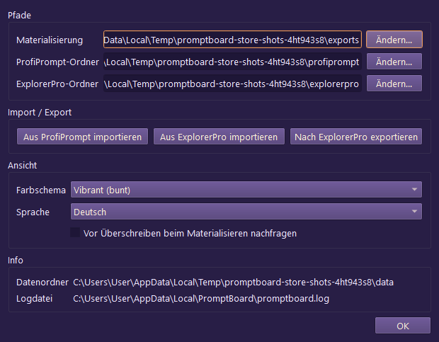

<p>
  <a href="./README.md">🇬🇧 English</a> &nbsp;·&nbsp; <a href="./README_de.md">🇩🇪 Deutsch</a> &nbsp;·&nbsp; <a href="./README_es.md">🇪🇸 Español</a> &nbsp;·&nbsp; <a href="./README_fr.md">🇫🇷 Français</a> &nbsp;·&nbsp; <a href="./README_zh.md">🇨🇳 简体中文</a> &nbsp;·&nbsp; <a href="./README_ja.md">🇯🇵 日本語</a> &nbsp;·&nbsp; <a href="./README_ru.md">🇷🇺 Русский</a> &nbsp;·&nbsp; <a href="./README_hi.md">🇮🇳 हिंदी</a> &nbsp;·&nbsp; <a href="./README_ar.md">🇸🇦 العربية</a> &nbsp;·&nbsp; <a href="./README_bn.md">🇧🇩 বাংলা</a> &nbsp;·&nbsp; <b>🇵🇹 Português</b>
</p>

<p>
  
  
  
  
  
  
  
  
</p>

# PromptBoard

**Sua biblioteca local de prompts — rápida, offline e pronta para a bandeja do sistema.**

> [!NOTE]
> **Esclarecimento:** `file-bricks/promptboard` é um aplicativo nativo de bandeja do sistema para desktop Windows, feito com Python e PySide6 e que prioriza o uso local. Foi projetado para gerenciar prompts de LLM offline e materializar arquivos Markdown localmente. Não é um serviço web em nuvem, uma plataforma SaaS nem uma extensão de navegador.

> [!TIP]
> **Integração com LLMs / agentes:** consulte [`llms.txt`](./llms.txt) para ver o contexto do projeto em formato legível por máquinas, os limites da API, os padrões de execução da CLI e as invariantes da arquitetura.

[Recursos](#key-features--goals) &nbsp;·&nbsp; [Arquitetura](#architecture--data-flow) &nbsp;·&nbsp; [Capturas de tela](#screenshots) &nbsp;·&nbsp; [Instalação e execução](#running-the-project) &nbsp;·&nbsp; [Documentação](#onboarding)

---

PromptBoard é um utilitário rápido para desktop e um aplicativo de bandeja do sistema para Windows, voltado a blocos reutilizáveis para LLMs: prompts, skills, fluxos de trabalho, funções e agentes. Ao contrário de gerenciadores de prompts maiores, seu foco principal não é o histórico de versões nem sistemas de quadros complexos, mas o acesso rápido: abrir, filtrar, copiar, editar diretamente e, quando necessário, materializar como arquivos `.md`. Suas bibliotecas de prompts permanecem offline, pesquisáveis e prontas para copiar, sem exigir uma conta na nuvem ou conexões com APIs externas.

## Status

**Fase:** lançamento público (`v1.1.3`); o trabalho de reforço para lojas e plataformas está em andamento no desenvolvimento local<br/>
**Código:** aplicativo desktop em PySide6 com 126/126 testes pytest aprovados<br/>

**CI:** [Testes do PromptBoard](https://github.com/file-bricks/promptboard/actions/workflows/tests.yml) executam Pytest no Windows e verificações de fumaça do código-fonte no macOS/Linux<br/>
**Repositório:** [file-bricks/promptboard](https://github.com/file-bricks/promptboard)<br/>

### Resultado da verificação — 2026-09-18

- `python -X utf8 -m pytest -q`: **125 aprovados, 1 ignorado (126 no total)** (escopo: suíte de testes Python; o teste de captura de tela é ignorado corretamente em ambiente headless offscreen).
- `python -X utf8 tests/source_platform_smoke.py`: **OK** (verificação de fumaça do código-fonte/offscreen; não afirma paridade nativa de bandeja ou atalhos de teclado no macOS/Linux).
- `python -X utf8 -m compileall -q src _tools tests scripts`: **OK**.
- `ruff check src _tools tests scripts`: **OK** (todas as verificações passaram).
- A versão `v1.1.3` foi publicada no GitHub; o Store-P1 continua aberto porque ainda não estão disponíveis valores reais do Partner Center, uma compilação MSIX local com `makeappx.exe` e uma leitura do WACK com privilégios elevados.

<a id="architecture--data-flow"></a>
## Arquitetura e fluxo de dados



<a id="screenshots"></a>
## Capturas de tela

A prévia local do README e as quatro capturas da loja são geradas diretamente a partir do estado atual da interface.








Estas capturas da loja podem ser geradas novamente de forma reproduzível por meio de `_tools/generate_store_screenshots.py`.

<a id="key-features--goals"></a>
## Recursos e objetivos principais

O PromptBoard funciona como uma ferramenta compacta na bandeja do sistema para gerenciar blocos de conhecimento local:

- Prompts
- Skills
- Fluxos de trabalho
- Funções
- Agentes

Cada entrada pode ser editada diretamente, classificada por tipo e nome e copiada para a área de transferência com um clique. Uma opção no menu de contexto permite materializar uma entrada como um arquivo Markdown limpo (`.md`) em um local configurado (por padrão, a Área de Trabalho). O arquivo exportado é focado no conteúdo: cabeçalho H1, bloco compacto de metadados e, em seguida, o texto do prompt.

Atalhos globais permitem mostrar/ocultar a janela da bandeja e copiar rapidamente a entrada usada por último.

## Comparação

- **Mais leve que o ProfiPrompt:** não há um grande histórico de versões nem um sistema de quadros pesado no núcleo.
- **Mais robusto que o AutoPrompter:** não há lógica frágil baseada em teclado ou hooks de daemon.
- **Mais privado que ferramentas na nuvem:** funciona inteiramente offline, sem sincronização de contas, APIs externas ou telemetria.

<a id="onboarding"></a>
## Primeiros passos

| Para... | Leia... |
|---|---|
| Primeira sessão | [START.md](./START.md) |
| Estado atual | [STATE.md](./STATE.md) |
| Visão do produto | [KONZEPT.md](./KONZEPT.md) |
| Visão geral dos recursos | [Feature_Analyse_PromptBoard.md](./Feature_Analyse_PromptBoard.md) |
| Arquitetura | [ARCHITECTURE.md](./ARCHITECTURE.md) |
| Glossário | [GLOSSARY.md](./GLOSSARY.md) |
| Diretrizes para agentes | [AGENTS.md](./AGENTS.md) e [CLAUDE.md](./CLAUDE.md) |

## Próximas etapas

O próximo foco principal é concluir o caminho Store-P1: inserir valores reais do Partner Center e documentar a execução do WACK com privilégios elevados contra `releases/PromptBoard.msix`. Os testes de fumaça do código-fonte no macOS/Linux agora fazem parte do projeto e do pipeline de CI.

<a id="running-the-project"></a>
## Executar o projeto

```powershell
python -m pip install -e ".[dev]"
python src\promptboard.py
```

No Windows, também é possível iniciar o aplicativo clicando duas vezes em `start.bat`.

## Licença

O PromptBoard é licenciado sob [MIT](LICENSE). As licenças das dependências de execução estão
listadas em [THIRD_PARTY_LICENSES.txt](THIRD_PARTY_LICENSES.txt).
